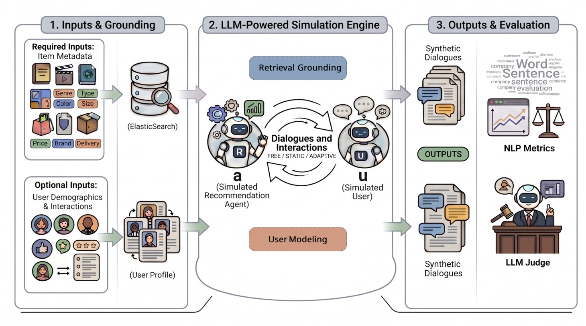

# OmniSim: Conversational Recommendation Dialogue Simulator


[](https://dl.acm.org/doi/10.1145/3774935.3812730)

OmniSim generates multi-turn conversational recommendation dialogues between a simulated user and a recommender agent. Both sides are played by an LLM; the items the agent recommends always come from a retrieval step over your own item catalogue, so recommendations are grounded in real items rather than invented by the model. Only an item metadata CSV is required; user demographics and rating histories are optional and enable personalisation.

> **Which version should I use?**
>
> - **The version described in the UMAP '26 paper is tag [`v1.0`](https://github.com/irecsys/OmniSim/tree/v1.0).** It uses Elasticsearch for retrieval. The Elasticsearch-based code line is available on branch [`v1.x`](https://github.com/irecsys/OmniSim/tree/v1.x).
> - **v2.0.0 (this branch)** replaces Elasticsearch with a local backend (SQLite FTS5 for BM25 + NumPy for vector search). No search server is needed. Scores differ slightly from Elasticsearch's (BM25 implementation, vector normalisation); [`legacy_es_equivalence/`](legacy_es_equivalence/) holds the recorded v1 results and a replay check showing that the retrieval pipeline reproduces them when Elasticsearch's scoring is substituted.
> - Neither tag reproduces the numbers reported in the paper exactly: the dialogues are generated by hosted LLMs, whose outputs are not deterministic.



---

## Contents

- [Features](#features)
- [Project structure](#project-structure)
- [Installation](#installation)
- [Configuration](#configuration)
- [Building the index](#building-the-index)
- [Running simulations](#running-simulations)
- [How a dialogue is generated](#how-a-dialogue-is-generated)
- [Rate limits and quota errors](#rate-limits-and-quota-errors)
- [Errors, fallbacks and the run summary](#errors-fallbacks-and-the-run-summary)
- [Reproducibility](#reproducibility)
- [Using your own data](#using-your-own-data)
- [Code defaults vs. `system.yaml`](#code-defaults-vs-systemyaml)
- [Data sources](#data-sources)
- [Citation](#citation)

More documentation: [`docs/API.md`](docs/API.md) (module reference) and [`docs/hm_pipeline.md`](docs/hm_pipeline.md) (H&M data preparation).

---

## Features

- **Works from item metadata alone.** Any item CSV with an id, a title and descriptive text. Domain wording is configured through roles (`role_user`, `role_bot`) and prompt templates.
- **Retrieval-grounded recommendations.** The agent only recommends items returned by hybrid retrieval (BM25 + dense vectors) over the catalogue. Free text written by the LLM (chit-chat, explanations) can still mention titles outside the catalogue.
- **Three dialogue modes**: Free (open-ended), Static (asks about attributes listed in the dataset config), Adaptive (also asks about attributes proposed by the LLM).
- **Four generation strategies**: predefined user–item pairs, item lists, user lists, and random items with anonymous users.
- **Optional personalisation** from demographics and rating histories (long-term and short-term preference profiles).
- **Probabilistic behaviours**, each controlled by a ratio in the config: chit-chat, explained rejections, recommendation explanations, short replies.
- **Evaluation tools**: reference-free lexical diversity metrics and LLM-as-a-Judge scoring (`scripts/compute_nlp_metrics.py`, `utils/judge.py`; see `docs/API.md`).
- **Local retrieval backend**: no Elasticsearch, no search server. The built-in datasets ship with precomputed item embeddings, so building the index makes no API call.

---

## Project structure

```
OmniSim/
├── run.py                     # Entry point: run simulations, --build-index
├── requirements.txt, .env.example
├── configs/
│   ├── system/system.yaml     # Global defaults (all parameters commented)
│   ├── imdb/imdb.yaml         # IMDB movies (inputs/ holds the strategy inputs)
│   ├── hm/hm.yaml             # H&M fashion
│   └── prompts/               # LLM prompt templates and phrase pools (editable)
├── data/
│   ├── imdb/                  # items.csv (with precomputed vectors), users.csv, interactions.csv
│   ├── imdb_fixture/          # small IMDB variant used by the equivalence recordings
│   ├── hm/                    # hm.zip (unpacks to hm.csv with precomputed vectors), users.csv, interactions.csv
│   └── redial/                # movies_with_mentions.csv (ReDial dialogues are downloaded separately)
├── utils/
│   ├── simulator.py           # Free / Static / Adaptive dialogue loops
│   ├── quick_start.py         # Orchestration, strategies, parallel runs
│   ├── utils.py               # LLM clients, dialogue acts, constraint parsing
│   ├── llm_calls.py           # Error handling, fallbacks, run summary
│   ├── retrieval/             # Local backend: index, BM25 (FTS5), vector search, filters
│   ├── user_profile_builder.py
│   ├── hm/preprocessor.py     # H&M data preparation (see docs/hm_pipeline.md)
│   ├── judge.py, evaluator.py, metrics.py, compare_*.py   # evaluation
│   └── …
├── scripts/                   # build_local_index.py, run_rate_limited.py, compute_nlp_metrics.py,
│                              # run_judge_all.py, convert_redial.py, sample_baseline.py, …
├── legacy_es_equivalence/     # Recorded v1 Elasticsearch results and the replay check
├── tests/                     # Offline tests (pytest)
├── docs/                      # API.md, hm_pipeline.md
├── img/                       # design figure
└── .github/workflows/test.yml # CI: pytest and the equivalence replay
```

Created at run time (ignored by git): `index/` (one directory per dataset), `chats/` (dialogues and run summaries), `logs/`, `results/`.

---

## Installation

Requirements:

- Python 3.10 or later (tested on 3.10), with SQLite compiled with FTS5. The standard CPython builds on Linux, macOS and Windows include it; OmniSim stops with a clear message if it is missing.
- An LLM API for dialogue generation (see [Providers](#providers)).
- An embeddings API for query embeddings, or, optionally, local `sentence-transformers` (see [Optional: local embeddings](#optional-local-embeddings)).
- `unzip`, to unpack the H&M catalogue (see below).

```bash
git clone https://github.com/irecsys/OmniSim.git
cd OmniSim

python -m venv .venv
source .venv/bin/activate          # Windows: .venv\Scripts\activate
pip install -r requirements.txt

cp .env.example .env               # then fill in the keys you need
```

The H&M catalogue is shipped compressed. To use it:

```bash
unzip -o data/hm/hm.zip -d data/hm/
```

This unpacks `data/hm/hm.csv` (about 108 MB, including the precomputed vectors). Optional check:

```bash
echo "998e43f6c093b7c982787b858fc7add1f572a738deb854dc6b3e0832e786935d  data/hm/hm.csv" | sha256sum -c -
```

### Optional: local embeddings

`sentence-transformers` is not installed by `requirements.txt`. It is needed only for `embeddings_provider: sentence-transformers` (item and query vectors computed locally, no API key) and for the cosine-diversity metric of the evaluation tools (`scripts/compute_nlp_metrics.py`, `utils/compare_metrics.py`). The default setup (Azure embeddings with the shipped precomputed vectors) does not use it. To install it in the activated venv:

```bash
pip install "sentence-transformers>=2.2.0,<7"
```

This also installs PyTorch. On a machine without a GPU, install the CPU build of PyTorch first; this downloads about 3 GB less and takes about 4 GB less disk space than the default build:

```bash
python -m pip install --upgrade pip    # older pip versions fail on the PyTorch package index
pip install torch --index-url https://download.pytorch.org/whl/cpu
pip install "sentence-transformers>=2.2.0,<7"
```

The first time the client is created, the model (`embeddings_model`, default `all-MiniLM-L6-v2`, about 90 MB) is downloaded from Hugging Face into the local cache; later runs load it from there.

### Tested environment

Ubuntu 24.04, Python 3.10.

---

## Configuration

`run.py --config` takes one or more YAML files in a single quoted, space-separated argument. `configs/system/system.yaml` is always loaded first, and later files override earlier ones:

```bash
python run.py --config "configs/imdb/imdb.yaml my_settings.yaml"
```

### API keys (`.env`)

| Variable | Used by |
|---|---|
| `OPENAI_KEY` | `openai` provider (chat and embeddings) |
| `AZURE_KEY` | `azure` and `azure_foundry` providers (chat), `azure` embeddings |
| `THETA_KEY` | `thetaedgecloud` provider |

The evaluation tools read additional variables (judge models, Azure AI Foundry endpoint); they are listed with comments in `.env.example`. Note that the judge's `azure` option reads `OPENAI_KEY`, not `AZURE_KEY`.

### Providers

Chat (`openai_provider`):

| Value | What to set |
|---|---|
| `openai` | `chat_model`; key `OPENAI_KEY` |
| `azure` | `chat_model` (the deployment name), `chat_endpoint` (resource root, e.g. `https://YOUR_RESOURCE.openai.azure.com/`), `chat_api_version`; key `AZURE_KEY` |
| `azure_foundry` | `chat_model` (the deployment name), `chat_endpoint` (the project's OpenAI-compatible base URL, ending in `/openai/v1`); `chat_api_version` is not used; key `AZURE_KEY` |
| `thetaedgecloud` | `chat_model`; key `THETA_KEY`. The paper's LLaMA-3.1-70B results were generated through this provider. ThetaEdgeCloud rejects concurrent requests (HTTP 409, retried with back-off), so use `--num-workers 1`. |

`azure_foundry` passes `chat_endpoint` to the OpenAI client as its base URL; it is intended and tested for Azure AI Foundry only. A documented option for other OpenAI-compatible servers (vLLM and others) is planned for v2.1.

Embeddings (`embeddings_provider`): `openai`, `azure`, or `sentence-transformers` (local, no key; optional package, see [Optional: local embeddings](#optional-local-embeddings)). There is no `azure_foundry` embeddings client.

- If `embeddings_provider` is not set, it defaults to `openai_provider`. **When chat uses `azure_foundry` or `thetaedgecloud`, set `embeddings_provider` explicitly.**
- For `azure` embeddings, set `embeddings_model`, `embeddings_endpoint` and `embeddings_api_version`. `embeddings_endpoint` must be the **resource root** (`https://YOUR_RESOURCE.openai.azure.com/`), not a full request URL.
- The endpoints cannot be set through environment variables. Put your own values in `system.yaml`, or in a small YAML file containing only `chat_endpoint:` and `embeddings_endpoint:` that you pass as an extra `--config` file and keep out of version control.
- The shipped precomputed item vectors were produced with `text-embedding-3-small` (1536 dimensions). Query embeddings must come from the same model. An index records the provider and model it was built with, and OmniSim stops if they do not match the configuration. If you switch `embeddings_provider` (for example from `azure` to `openai` with the same model), rebuild the index with `--build-index`; with precomputed vectors this makes no API call.

The shipped `system.yaml` uses `openai_provider: azure` with `chat_model: gpt-4o-mini` and Azure embeddings; both endpoints are placeholders. Fill in your own resource, or use one of the examples below.

### Example configurations

```yaml
# A. Azure OpenAI for chat and embeddings (the shipped default; fill in your resource)
openai_provider: azure
chat_model: gpt-4o-mini                      # deployment name
chat_endpoint: https://YOUR_RESOURCE.openai.azure.com/
chat_api_version: "2024-02-01"
embeddings_provider: azure
embeddings_model: text-embedding-3-small     # deployment name
embeddings_endpoint: https://YOUR_RESOURCE.openai.azure.com/
embeddings_api_version: "2024-02-01"

# B. OpenAI for chat and embeddings (rebuild the index once: --build-index, no API call)
openai_provider: openai
chat_model: gpt-4o-mini
embeddings_provider: openai
embeddings_model: text-embedding-3-small

# C. ThetaEdgeCloud for chat, Azure for embeddings (run with --num-workers 1)
openai_provider: thetaedgecloud
chat_model: meta-llama/Meta-Llama-3.1-70B-Instruct
embeddings_provider: azure                   # plus the azure embeddings keys from A
```

`sentence-transformers` models produce vectors of a different size from the shipped ones. To use one, remove `precomputed_embedding_col` from the dataset config and rebuild the index (this embeds every item locally).

---

## Building the index

Each dataset has its own index directory under `index/` (for example `index/imdb`). It contains the SQLite database (items and the FTS5 table), the item vectors and an embedding cache (`embedding_cache.db`).

```bash
python run.py --config configs/imdb/imdb.yaml --build-index
python run.py --config configs/hm/hm.yaml --build-index
```

- If the index is missing when you run a simulation, it is built automatically. Automatic building only uses precomputed vectors and never calls the embeddings API; if the dataset has no precomputed vector column, it stops and asks you to run `--build-index`.
- `--build-index` embeds items that have no precomputed vector with the configured embeddings provider (this calls the API and is billed) and caches the vectors in `embedding_cache.db`.
- `scripts/build_local_index.py --config "…"` does the same as `run.py --build-index` and adds `--dry-run` (reports how many items would be embedded; no API call, nothing written) and `--max-embed-items N` (refuses to embed more than N items).
- Scale: all item vectors are held in memory and scored exactly. Memory grows with items × dimensions × 4 bytes. The shipped catalogues (200 and 3,246 items; the H&M vectors take about 20 MB) are what we have tested; larger catalogues have not been benchmarked.

---

## Running simulations

```bash
# All strategies configured for the dataset, default mode
python run.py --config configs/imdb/imdb.yaml

# Choose the dialogue mode
python run.py --config configs/imdb/imdb.yaml --mode adaptive

# One strategy only (comma-separated for several)
python run.py --config configs/imdb/imdb.yaml --strategy user_item_pairs

# Number of parallel workers
python run.py --config configs/imdb/imdb.yaml --num-workers 4

# Small smoke test: 2 pairs, 1 dialogue each, one worker
head -3 configs/imdb/inputs/test_pairs.csv > /tmp/pairs_2.csv
python run.py --config configs/imdb/imdb.yaml --strategy user_item_pairs \
  --pairs-file /tmp/pairs_2.csv --chats-per-entry 1 --num-workers 1
```

Note that `configs/imdb/inputs/test_pairs.csv` itself has 200 pairs.

Dialogues are written to

```
chats/{dataset}/{mode}/{strategy}/{run_timestamp}/
  {user_id}-{item_id}-{turns}-{rec_attempts}-{succeed}-{timestamp}.txt
```

`user_id` is `user` for anonymous users. `succeed=1` means the target item was recommended and accepted. If two dialogues would get the same file name (same user, item, counts and second), the timestamp of the later one is moved forward by one second, so no dialogue is overwritten.

---

## How a dialogue is generated

Each dialogue has a hidden **target item**. The simulated user describes what they want based on the target's metadata (without naming it); the agent asks questions and recommends items found by retrieval. The dialogue ends when the target is recommended and accepted, when `max_rec_attempts` recommendations have been shown (default 6), or when `max_total_rounds` rounds have passed (default 30, a safety stop).

### Dialogue modes

| Mode | What the agent asks | Best for |
|---|---|---|
| `free` | Open-ended follow-up questions; the user answers in free text generated from the target's details. | Diverse, unstructured language |
| `static` | One attribute from `item_attributes` in the dataset config per question, **in the order they are listed**. With `max_questions: 3`, every static dialogue asks about the same first three attributes (for IMDB: `adult`, `genres`, `original_language`). | Slot-filling and attribute-based systems |
| `adaptive` | The LLM proposes additional attributes for the item; these are asked first, then the configured ones, after an LLM filter removes attributes that do not fit the item. The user answers from the item's text. | Varied attribute questions |

Set the mode with `mode_refinement` in `system.yaml` or `--mode`.

### When to ask and when to recommend

In every round the agent may ask one question (until `max_questions` questions have been asked, or, in static/adaptive mode, until no attribute is left) and then always runs retrieval and tries to recommend. After the question budget is used up, every round is a recommendation round. In practice, *when to ask* and *when to recommend* are determined by `max_questions`, the number of available attributes, `max_rec_attempts` and `max_total_rounds`.

### Generation strategies

Without `--strategy`, strategies run in the order below; with `--strategy`, in the order given.

| Strategy | Runs when | Input | User information used |
|---|---|---|---|
| `user_item_pairs` | `input_pairs_file` is set | CSV of (user, item) pairs; `chats_per_entry` dialogues each | full profile |
| `item_list` | `input_items_file` is set | CSV of target items; `chats_per_entry` dialogues each | a random user if `users.csv` exists, otherwise anonymous |
| `user_guest` | `input_users_file` is set, or `--strategy user_guest` (then all users in `users.csv`) | users; target items are sampled; `chats_per_user` dialogues each (else `chats_per_entry`, else 5) | demographics only (preference profiles are not used) |
| `items` (random) | `guestuser_randomitem_records` is set, or no other strategy is configured | number of dialogues (default 40) | anonymous |

On H&M, avoid the `user_guest` strategy: its target items are not found, so its dialogues cannot succeed, and an `items` strategy later in the same run is affected in the same way. The shipped `hm.yaml` runs all four strategies, so choose them with `--strategy` (for example `--strategy user_item_pairs,item_list,items`). Each affected dialogue is logged as a WARNING and counted as `target_not_found` in the run summary.

### Retrieval and scoring

For a query `q` built from the user's messages, the backend takes the top `3 × max_similar_items` candidates by exact cosine similarity (after hard filters such as year ranges or excluded genres parsed from the dialogue) and scores them:

```
S_cos(q, i)  = (1 + cos(q, i)) / 2                       # in [0, 1]
S_bm25(q, i) = min–max normalised BM25 among the candidates that match (others 0)
base(q, i)   = λ · S_bm25(q, i) + (1 − λ) · S_cos(q, i)
score(u, i)  = α · base(q, i) + (1 − α) · [β · S_cos(i, p_short) + (1 − β) · S_cos(i, p_long)]
```

`p_long` and `p_short` are embeddings of the user's long-term and short-term preference summaries. Without a long-term profile, `score = base` (α = 1); with a long-term but no short-term profile, the β term is dropped.

| Parameter | Default | Meaning |
|---|---|---|
| `lambda_bm25` | 0.3 | λ: BM25 vs. cosine |
| `weight_es_score` | 0.7 | α: retrieval vs. user profile (name kept from v1) |
| `weight_user_taste_short` | 0.3 | β: short-term vs. long-term preference |
| `threshold_similarity` | 0.3 | τ: see below |
| `rec_top_n` | 1 | items shown per recommendation |

**Relevance threshold τ.** If `max(base) < τ`, no item is shown in that round; the round does not count as a recommendation attempt and the dialogue continues with the next round (another question if the budget allows, otherwise another retrieval). It does not add an extra clarifying question. The same happens when every retrieved item has already been rejected. With the defaults λ = τ = 0.3, `max(base)` cannot fall below τ whenever BM25 matches at least two candidates with different scores, so in practice the threshold only blocks a round when the hard filters leave no candidates.

---

## Rate limits and quota errors

OmniSim has **no global rate limiter**. With `--num-workers > 1` it sends requests as fast as the provider accepts them.

For ThetaEdgeCloud (100 requests per 10 minutes), use `--num-workers 1` and, for longer runs, the rate-limiting wrapper:

```bash
OMNISIM_CALL_RECORD=logs/calls.json python scripts/run_rate_limited.py --config configs/imdb/imdb.yaml --num-workers 1
```

- `OMNISIM_CALL_RECORD` (required) names a JSON file that records every LLM and embedding call and error.
- `OMNISIM_THETA_RATE` (default `95/600`: at most 95 requests in any 600 s) and `OMNISIM_THETA_WINDOW` (default `logs/theta_window.json`, shared by consecutive runs) configure the limit.
- Linux and macOS only (the script uses `fcntl`).

When a provider reports that the quota is used up, OmniSim **stops the whole run**: no new dialogues are started, in this strategy or later ones, and the skipped tasks are listed in the run summary with the reason. Re-run the unfinished tasks afterwards.

| Provider | Stops the run on | Notes |
|---|---|---|
| `openai`, `azure`, `azure_foundry` | `RateLimitError` for a daily limit; `insufficient_quota` | Per-minute rate limits (after the SDK's retries) only drop the affected dialogue and the run continues. |
| `thetaedgecloud` | HTTP 403 | May be the 10-minute window or the daily quota. Requests failing with 409, 429 or 503 are retried with back-off. |

Errors replaced by fallback text (next section) are counted but do not stop the run; the run stops when a quota error ends a dialogue (a call without a fallback, or `on_llm_error: fail`).

---

## Errors, fallbacks and the run summary

- Some LLM calls have a fallback (for example a template sentence instead of generated chit-chat). When a fallback is used, the dialogue file contains a `<FALLBACK>` line, so affected dialogues can be found.
- With `on_llm_error: fail` (default `fallback`), the first LLM error stops that dialogue, which is kept as a `.aborted` file, and no further dialogue is started; the remaining tasks are counted as `skipped`. Calls that have no fallback (for example the query embedding) stop the dialogue in both modes.
- Each run writes a summary to `chats/{dataset}/{mode}/run_summary_{run_timestamp}.json`. Its `conversations` section counts `dispatched`, `saved`, `succeeded`, `failed`, `stopped_by_max_total_rounds`, `target_not_found`, `aborted`, `dropped` and `skipped`; further sections report fallbacks, `empty_after_filters` and `dispatch_stopped`.
- `run.py` exits with 3 if anything went wrong with an LLM or embedding call: a fallback was used, a dialogue was aborted, dropped or skipped, a user profile could not be built, or the startup check failed. It exits with 1 if the run crashed or was interrupted, and with 0 otherwise. Dialogues that end without success are a normal outcome.

---

## Reproducibility

- `seed` (default 2025) makes single-threaded runs repeatable, except for target sampling in the `user_guest` strategy, which is not seeded.
- With `--num-workers > 1`, runs are not repeatable: threads share the global random number generators.
- LLM outputs are not deterministic, even at temperature 0 on most hosted services. Two runs with the same seed and settings will usually produce different dialogues.
- Use the shipped precomputed item vectors when comparing results; re-embedding the catalogue gives slightly different vectors.
- The H&M preprocessing script can overwrite `data/hm/hm.csv`, which contains the precomputed vectors. Always pass `--input` and `--output` explicitly and write the output outside `data/` (see `docs/hm_pipeline.md`). `hm.zip` keeps a copy of the original.

---

## Using your own data

1. Put your CSV files in `data/<dataset>/`: `items.csv` with at least an id column, a title column and a descriptive text column; optionally `users.csv` (demographics) and `interactions.csv` (user id, item id and rating columns, named by `col_userid`, `col_itemid` and `col_rating`; optionally `timestamp`).
2. Copy `configs/imdb/imdb.yaml` to `configs/mydata/mydata.yaml` and set `dataset`, `file_items` (and optionally `file_users`, `file_interactions`), `col_itemid`, `col_title`, `col_category`, `col_details` (and `col_userid`, `col_rating` if you have users), `embedding_fields`, `item_attributes`, `default_attributes`, `role_user`, `role_bot`, and the input of at least one strategy (`input_pairs_file`, `input_items_file`, `input_users_file` or `guestuser_randomitem_records`).
3. If `items.csv` has a precomputed embedding column, set `precomputed_embedding_col` to its name; otherwise leave it unset and build the index explicitly (this calls the embeddings API once per item):
   `python run.py --config configs/mydata/mydata.yaml --build-index`
4. Run: `python run.py --config configs/mydata/mydata.yaml`
5. Review the prompt templates in `configs/prompts/` for wording that does not fit your domain.

For catalogues in languages without spaces between words (for example Chinese or Japanese), set `bm25_tokenizer: trigram` in the dataset config (needs SQLite 3.34 or later; terms shorter than three characters do not match) and rebuild the index.

---

## Code defaults vs. `system.yaml`

`system.yaml` is always loaded first, so the values in the code below only apply if you delete a key from `system.yaml` (some keys, for example `rec_top_n`, are then required and the run stops) or call the functions directly without the config.

| Key | `system.yaml` | Code default |
|---|---|---|
| `openai_provider` | `azure` | `openai` |
| `chat_model` | `gpt-4o-mini` | `llama_3_1_70b` (ThetaEdgeCloud only) |
| `embeddings_model` | `text-embedding-3-small` | `all-MiniLM-L6-v2` (sentence-transformers only) |
| `num_workers` | 8 (imdb.yaml: 8, hm.yaml: 3) | 4 |
| `max_questions` | 3 | 99 |
| `rec_top_n` | 1 | required; 2 in the acceptance phrase only |
| `chit_chat_ratio` | 0.75 | 0.0 |
| `rec_explanation_ratio` | 0.5 | 0.0 |
| `rejection_explanation_ratio` | 0.7 | 0.0 |
| `short_reply_ratio` | 0.2 | 0.45 |
| `temp_chitchat` | 1.2 | 1.0 for the failure closing message, 1.2 for chit-chat |
| `temp_free_user` | 0.7 | 1.0 |
| `temp_rec_explain` | 0.7 | 0.9 |
| `temp_rejection` | 0.7 | 0.9 |
| `temp_rephrase` | 0.8 | 0.3 |
| `show_chit_chat_tag` | false | true |
| `show_profile_note` | false | true |
| `short_term_days` | 30 | 7 |
| `data_path` | `data/` | `data` (same) |
| `col_category` | `category` (imdb.yaml: `genres`, hm.yaml: `gender_type`) | `''` or `category` |
| `reference_blend_weight` | (not set) | 0.3 |

Some temperatures have no config key: rephrasing follow-up questions 0.7, query expansion 0.3, attribute questions 0.7, item type extraction 0, attribute value extraction 0, candidate attributes 0.5, attribute filtering 0, profile building 0.3.

---

## Data sources

- **IMDB** (movies): user ratings from the [IMDB users' ratings dataset](https://ieee-dataport.org/open-access/imdb-users-ratings-dataset) and movie metadata from [IMDB metadata on Kaggle](https://www.kaggle.com/datasets/serdarsozturk/imdb-metadata). The shipped catalogue has 200 movies, 20 users and 56 interactions; user demographics are simulated.
- **H&M** (fashion): products from the [H&M product dataset on Kaggle](https://www.kaggle.com/datasets/niharpatel03/h-and-m-product-dataset) (3,246 items). Users and interactions are simulated.
- **ReDial** (human–human movie recommendation dialogues, [Li et al., 2018](https://redialdata.github.io/website/)), used as the human baseline. Only `data/redial/movies_with_mentions.csv` is shipped. Download the ReDial dataset and put `train_data.jsonl` and `test_data.jsonl` in `data/redial/`; `scripts/convert_redial.py` converts them into OmniSim's dialogue format (`chats/redial/real/`).

Please check each source's license before redistributing data.

---

## Citation

If you use OmniSim in your research, please cite:

```bibtex
@inproceedings{zheng2026omnisim,
  title     = {OmniSim: A LLM-Powered Open-Source Simulator for Generating Personalized and Adaptive Conversational Recommendation Dialogues},
  author    = {Zheng, Yong and Zhang, Jian},
  booktitle = {Proceedings of the 34th ACM Conference on User Modeling, Adaptation and Personalization (UMAP '26)},
  year      = {2026},
  doi       = {10.1145/3774935.3812730}
}
```

---

## License

Apache 2.0; see [LICENSE](LICENSE).
